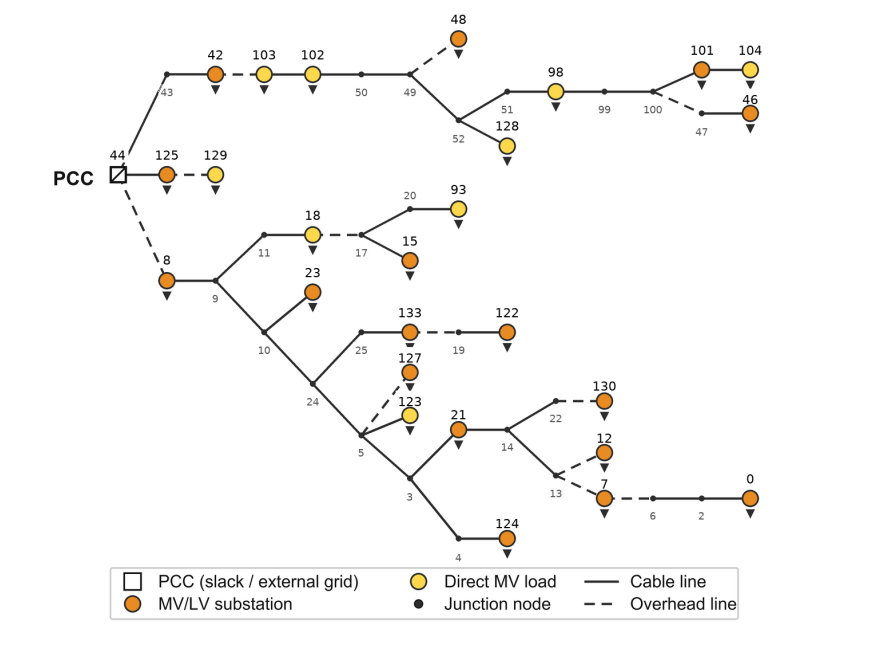

# Flexible Operating Regions for a Swiss MV Distribution Grid



This repository contains the final Python implementation, prepared input data, and project report for the computation and analysis of multi-timestep Feasible Flexibility Operating Regions (FFORs) for a synthetic 20 kV medium-voltage distribution grid in Eschenbach SG, Switzerland.

The project investigates how network constraints, future distributed energy resource (DER) deployment, resource location, and flexibility activation duration affect the flexibility deliverable at the point of common coupling (PCC). It evaluates three enhancement strategies: physical-line reinforcement, additional grid-scale battery energy storage systems (BESS), and large-scale photovoltaic (PV) installations.

## Project Report

**Analysis and Enhancement of the Flexibility Potential of a Swiss Medium-Voltage Distribution Grid**  
Pierpaolo Musiello, Alessandro Falezza, and Luca Lazzari  
ETH Zürich — Power Systems Laboratory

**[Read the full project report (PDF)](Report_Musiello_Falezza_Lazzari.pdf)**

The report presents the research question, modelling assumptions, scenario design, sensitivity analyses, results, and conclusions. Its appendices document the optimization variables, parameters, constraints, objective function, and input-data processing.

## Overview

The model builds a linearized distribution-grid optimization problem and uses a QuickFlex-style boundary search to construct the FFOR at the PCC. The resulting polygon describes the active- and reactive-power deviations that can be sustained over a selected activation horizon while respecting voltage, line, DER, BESS state-of-charge, and temperature-dependent heat-pump constraints.

The study uses hourly DER projections for 2030, 2040, and 2050 on a synthetic MV network with 51 buses, 50 lines, and 26 load nodes. It compares baseline operating conditions with line reinforcement, additional BESS installations, and additional PV fields, including sensitivity to installation location, capacity, and flexibility duration.

The repository is intended as a reproducible final project delivery: it contains the main modules, prepared data folders, the accompanying technical report, and a compact example run that writes the FFOR boundary directly to CSV and PNG files.

## Key Findings

The following findings summarize the analyses presented in the [project report](Report_Musiello_Falezza_Lazzari.pdf); they are **scenario-specific research results**, not outputs automatically reproduced by the default `python run.py` example.

- **Network constraints:** The baseline feasibility analysis identified **649 infeasible operating points** across the 2040 and 2050 scenarios, attributable to line apparent-power violations. Voltage limits were not binding in the cases examined. Higher DER penetration does not automatically imply more flexibility deliverable at the PCC, because growing EV and heat-pump demand also increases network loading.
- **Line reinforcement:** Reinforcing selected critical branches primarily increases negative active-power flexibility (increased consumption or reduced generation). The benefits are generally greater in the more heavily constrained 2050 scenario than in 2030. Reinforcement addresses structural network bottlenecks and was the only intervention assessed for restoring baseline feasibility across the full daily profile.
- **BESS placement and sizing:** For a **1 MW / 2.5 MWh BESS** evaluated on **15 December 2050 at 12:00**, with a **four-hour sustained horizon**, the FFOR-area gain varied from **1.05 to 18.08 MW·MVAr** depending on location. Nodes **125 and 129** achieved the largest gains (approximately **34.8%**), demonstrating the importance of local thermal headroom and topology. The BESS contribution also depends on installed power, energy capacity, and activation duration.
- **Large-scale PV:** Additional PV primarily increases negative active-power flexibility through curtailment. For the one-hour horizon, this gain is approximately proportional to installed PV capacity in the scenarios analysed. Longer sustained activation reduces the benefit; PV can relieve certain daytime bottlenecks but cannot generally replace structural reinforcement under heavily constrained future operating conditions.

See the report for the full scenario definitions, quantitative comparisons, figures, qualifications, and discussion of limitations.

## Requirements

- Python 3.10 or newer.
- A valid Gurobi license.
- Python packages listed in `requirements.txt`.

Install the required packages from the repository root:

```powershell
pip install -r requirements.txt
```

## Quick Start

1. Check or edit the scenario settings in `config.py`.
2. Ensure that the required grid and profile data are present under `06_Grids/` and `outputs/`.
3. Run the model from the repository root:

```powershell
python run.py
```

Each run writes the following files in the repository root, replacing files from the previous run:

- `ffor_boundary.csv`
- `ffor_boundary.png`

By default, the code looks for data inside this repository. To keep the data elsewhere, set `FFOR_DATA_ROOT` to the directory containing `06_Grids/` and `outputs/` before running the model. This supports read-only, authorized, or cloud-synchronized data locations without editing the Python modules.

The year, target timestamp, timestep count, and timestep duration can also be set through environment variables:

- `FFOR_DATA_YEAR`
- `FFOR_TARGET_TIME`
- `FFOR_N_TIMESTEPS`
- `FFOR_DT_H`

## Repository Structure

| Path | Purpose |
| --- | --- |
| `Report_Musiello_Falezza_Lazzari.pdf` | Full project report, including methodology, results, conclusions, and mathematical appendices. |
| `config.py` | Scenario, DER, BESS, PV, and reinforcement configuration. |
| `loader.py` | Grid and profile loading utilities. |
| `model_data.py` | Prepared-profile processing and optimization-data assembly. |
| `optimization.py` | Linear multi-timestep FFOR optimization model. |
| `run.py` | QuickFlex boundary calculation and output generation. |
| `requirements.txt` | Python package requirements. |
| `data_checksums_sha256.csv` | Optional SHA-256 manifest for checking prepared data files. |
| `images/` | Grid topology image used in this README. |
| `06_Grids/` | Grid topology and electrical data. |
| `outputs/` | Prepared yearly demand, DER, weather, and allocation profiles. |

## Data Layout

Run the code from the repository root and place the prepared data underneath it using the following structure:

```text
Optimization-in-Energy-Systems/
|-- 06_Grids/
|   |-- 20_0_nodes.txt
|   |-- 20_0_edges.txt
|   |-- 20_0_matpower.xlsx
|   |-- 20_0_bus_data.csv
|   |-- 20_0_branch_data.csv
|   `-- 20_0_grid.xlsx
`-- outputs/
    |-- 20_0_profiles_mveq_evbase_2030/
    |-- 20_0_profiles_mveq_evbase_2040/
    `-- 20_0_profiles_mveq_evbase_2050/
```

Each yearly profile directory requires:

```text
baseline_demand_by_mv_node.csv
hp_baseline_by_mv_node.csv
pv_generation_by_mv_node.csv
ev_baseline_by_mv_node.csv
ev_baseline_q_by_mv_node.csv
bess_allocation_mveq.csv
ffor_inputs/time_columns.csv
ffor_inputs/temperature_profiles.csv
ffor_inputs/hp_mv_allocation.csv
ffor_inputs/hp_lv_allocation.csv
ffor_inputs/pv_mv_generation.csv
ffor_inputs/pv_lv_generation.csv
```

`data_checksums_sha256.csv` records the expected SHA-256 hash of each prepared data file. It is not required by the simulation, but it should be retained when the data package is transferred or downloaded so recipients can verify that the inputs are complete and unchanged.

## Scenario Configuration

The following studies can be configured directly in `config.py`:

- additional grid-scale PV installations through `GRID_SCALE_PV`;
- additional grid-scale BESS installations through `GRID_SCALE_BESS`;
- physical-line reinforcement through `REINFORCED_PHYSICAL_LINES`.

Leave these lists empty to simulate the original grid without additional grid-scale assets or reinforcement.

**Node-numbering convention:** the topology image above uses the node labels adopted in the paper. The Python code uses the internal bus IDs from the grid data, which are one number higher. For example, node `129` in the image and project report corresponds to code bus `130`.

## Data and Method Sources

The main data and modelling sources used in the project are:

- Oneto et al. (2024), "Large-Scale Generation of Geo-Referenced Power Distribution Grids Using Open Data", TechRxiv. DOI: [`10.36227/techrxiv.24607662.v3`](https://doi.org/10.36227/techrxiv.24607662.v3).
- Zapparoli et al. (2025), "Future Deployment and Flexibility of Distributed Energy Resources in the Distribution Grids of Switzerland", *Scientific Data*. DOI: [`10.1038/s41597-025-05830-y`](https://doi.org/10.1038/s41597-025-05830-y).
- Lopez et al. (2021), "QuickFlex: a Fast Algorithm for Flexible Region Construction for the TSO-DSO Coordination", SEST 2021. DOI: [`10.1109/SEST50973.2021.9543349`](https://doi.org/10.1109/SEST50973.2021.9543349).
- Arpagaus et al. (2023), "Field experience with residential heat pumps in Switzerland: Potential for improvement and future developments", 14th IEA Heat Pump Conference.
- Brändle et al. (2025), "On the Flexibility Potential of a Swiss Distribution Grid: Opportunities and Limitations", arXiv. DOI: [`10.48550/arXiv.2510.13449`](https://doi.org/10.48550/arXiv.2510.13449).
- Council of European Energy Regulators (2001), "Quality of electricity supply: Initial benchmarking on actual levels, standards and regulatory strategies".

Complete references are provided in the [project report](Report_Musiello_Falezza_Lazzari.pdf).

## Limitations

- The network is an MV-equivalent synthetic Swiss distribution grid derived from open data. LV cable and local transformer constraints are not explicitly represented, which is relevant when interpreting the high BESS-placement gains on lightly loaded MV stubs.
- The input profiles are hourly projections for the selected 2030, 2040, and 2050 scenarios, introducing uncertainty into future operating conditions.
- The optimization uses a first-order linearized power-flow model. It retains line resistance, reactance, and shunt susceptance, but does not represent nonlinear active-power losses.
- EV charging is treated as fixed demand rather than a controllable flexibility resource.
- The BESS state-of-charge dynamics use a lossless, unit-efficiency signed-power approximation; the study's storage gains should therefore not be interpreted as efficiency-adjusted operational forecasts.
- PV and BESS interventions are evaluated independently; coordinated PV–BESS operation is not considered.
- BESS units are inactive in the baseline, so the study does not evaluate whether BESS corrective dispatch can restore infeasible baseline operating points. Furthermore, the initial BESS state of charge is fixed across simulations.

## Contributors

- Luca Lazzari — MSc in Energy Science and Technology, ETH Zürich.
- Pierpaolo Musiello — MSc in Energy Science and Technology, ETH Zürich.
- Alessandro Falezza — MSc in Electrical Engineering and Information Technology, ETH Zürich.

## Citing

If you use this repository or the prepared data in further work, please cite the project report and the relevant data and method sources listed above. The full project report is available as [`Report_Musiello_Falezza_Lazzari.pdf`](Report_Musiello_Falezza_Lazzari.pdf).
